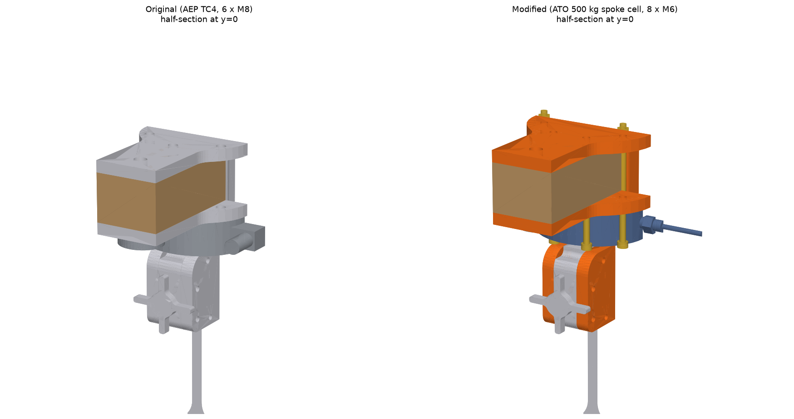
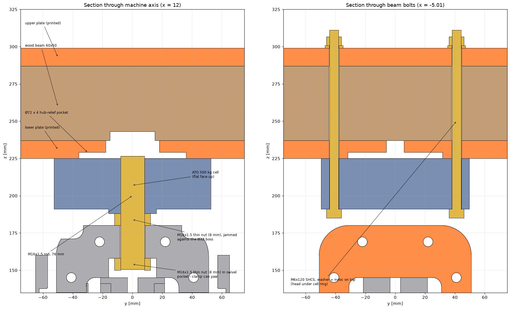
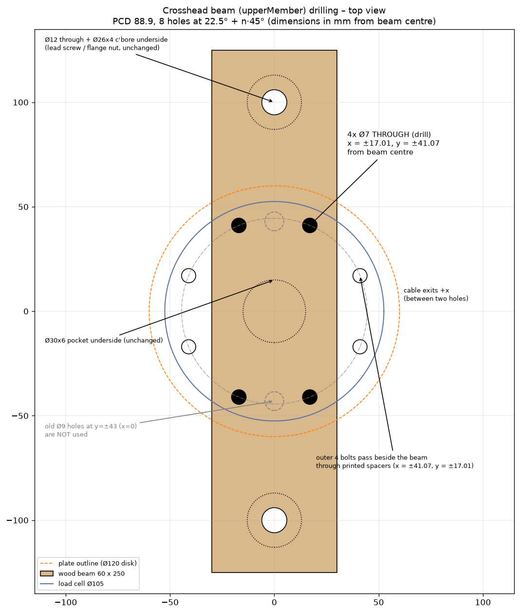

# Open-Pull with the ATO 500 kg spoke load cell

This folder adapts CNC Kitchen's Open-Pull to the **ATO 500 kg tension/compression "pancake" (spoke) load cell**
(Amazon ASIN B08CK7QNDT, ATO part LC-P02-01). The original machine used an AEP TC4 5 kN cell.

Everything here is generated by [generate_ato_mod.py](generate_ato_mod.py) from the original
`../OpenPull-assembly.step`. Change a parameter and re-run it with `python generate_ato_mod.py`
(needs `cadquery`).

## Load cell data used

From the ATO drawing, "500 kg – 7 ton" row, and the Amazon listing:

| | |
|---|---|
| Capacity | 500 kg (4.9 kN). The original AEP TC4 was 5 kN, so the machine's force range is unchanged |
| Body | Ø105 × 34 mm (E). There is a Ø32 boss on the load side that sticks out 3 mm (H = 37) |
| Mounting | 8 × Ø6.5 holes on an 88.9 mm bolt circle (M6) |
| Load thread | **M16 × 1.5 (fine pitch)** through the centre hub |
| Output | 2.0 ±0.1 mV/V, 350 Ω bridge, excitation 5–10 V, 150 % safe overload |
| Wiring | EXC+ red, EXC− black, SIG+ green, SIG− white |

## How it's mounted

* **Cell orientation.** The cell's **flat face goes up** against the lower crosshead plate. The **boss faces down** toward
  the upper clamp. A Ø72 × 4 mm pocket in the plate keeps the hub from touching anything, so only the outer
  ring is clamped. That's how spoke cells are meant to be mounted. The cable exits toward +X, between two holes.
* **Bolts.** 8 × M6 × 120 socket-head screws go up through the cell ring, the lower plate, the beam or a spacer,
  and the upper plate. Each gets a washer and nyloc nut on top. The holes sit at 22.5° + n·45°, so
  **4 bolts go through the wooden beam** and 4 pass beside it through two new printed spacers.
* **Upper clamp.** An M16 × 1.5 rod (76 mm) is screwed through the cell hub and locked with an 8 mm M16 × 1.5
  **thin nut** jammed against the boss. The clamp hangs on a second thin nut in its swivel pocket, as in the
  original design, so it can still yaw and self-align with the specimen.
* **Crosshead height.** The whole crosshead (plates, beam, spacers, cell, brass flange nuts) is **10 mm higher**
  than in the original CAD, to make room for the boss and the jam nut. The clamps, specimen position and frame
  are unchanged.
* **Lower clamp.** It uses the same rod stock (124 mm) through the bottom beam, with a washer and thin nut
  underneath. The original CAD didn't model this rod.
* **Flange nuts.** The lower plate is cut for the **Tr10x2 brass flange nuts that are actually sold on Amazon**
  (ReliaBot, uxcell, YEJMKJ: Ø32 flange, Ø16 body, 4 × Ø3.5 on a 24 mm bolt circle). It has a Ø16.5 locating bore
  and 4 pilot holes for M3 × 12 screws. The original CAD had a Ø42/Ø25 nut and a 5 mm-deep bore that clashed
  with the nut body.

## Two frame variants (lead-screw length)

| | Lead screws | Side pillars (60 × 80 wood) | Crosshead stroke | Specimens |
|---|---|---|---|---|
| `STEP/OpenPull-assembly_ATO-500kg.step` **(the one being built)** | 2 × Tr10x2 **500 mm** (McMaster 7549K72) | 780 mm (original) | **209 mm** | Everything, including ISO 527 1A (170 mm) |
| `STEP/OpenPull-assembly_ATO-500kg_400mm-screws.step` | 2 × Tr10x2 **400 mm** | **680 mm** (cut 100 mm shorter) | **109 mm** | The repo's ISO 527-2 1BA (110 mm) and layer-adhesion (82 mm) specimens, roughly 100 % strain. Not 1A |

In the 400 mm variant, the top beam (`mostUpperMember`), top bearings, couplers, motor brackets and motors all sit
100 mm lower. Nothing else changes. You can upgrade later to 500 mm screws and 780 mm pillars.

For comparison, the original machine has 228 mm of stroke. The mod loses 19 mm because the M6 bolt ends sit higher.

## Part changes

| Part | Status | File | Qty | Notes |
|---|---|---|---|---|
| Load cell | **Replaced** | `STEP/LoadCell_ATO_LC-P02-01_500kg.step` | 1 | Model built from the ATO drawing (reference only) |
| Lower crosshead plate (`upperMemberSupport`) | **New print** | `STL/upperMemberSupport_lower_ATO.stl` | 1 | 8 × Ø6.8 holes, centre disk Ø105 → Ø120, Ø72 × 4 hub pocket, flange-nut bore and M3 pilots. Already flipped for printing, pockets up |
| Upper crosshead plate (`upperMemberSupport (1)`) | **New print** | `STL/upperMemberSupport_upper_ATO.stl` | 1 | 8 × Ø6.8 holes, Ø120 centre disk |
| Spacer | **New print** | `STL/spacer_ATO_x2.stl` | 2 | Rounded-slot spacer for the outer bolts, 49.5 mm tall (beam is 50) |
| Clamp side part `SpecimenHolder_OuterPart` | **Modified print** | `STL/SpecimenHolder_OuterPart_ATO-pocket_x2.stl` | 2 | Swivel-nut pocket 2.5 mm deeper (6 → 8.5 mm) so a standard 8 mm M16 thin nut fits and can still turn |
| Clamp side part `SpecimenHolder_OuterPart (1)` | **Modified print** | `STL/SpecimenHolder_OuterPart(1)_ATO-pocket_x2.stl` | 2 | Same change, mirrored |
| Crosshead beam `upperMember` (wood 60 × 50 × 250) | **Re-drill** | `images/beam_drilling_and_hole_pattern.png` | 1 | 4 × Ø7 through at x = ±17.01, y = ±41.07 from the beam centre. The original 2 × Ø9 holes are not used |
| Side pillars (wood 60 × 80) | Cut 680 mm | — | 2 | **Only for the 400 mm-screw variant** |
| All other parts | Unchanged | original `../IndividualParts/*.stl` | — | — |

**Checks run on both assemblies:**
* A full interference check found no clashes involving any new or changed part. The only ones left are identical
  to the original CAD's own (lead-screw threads inside the printed nuts, the coupler in its bracket, a pressed-in
  tee nut). The original flange-nut/plate clash is fixed.
* The swivel nut was rotated 0–60° in both clamps with no clash.
* All STLs are watertight and laid flat in print orientation.

### Printing
The plates carry the cell load into the frame, so print them like the clamps: PETG/PCTG or PLA+, 0.2 mm layers,
5–6 walls, 4–5 top/bottom layers, ≥ 40 % gyroid infill. The plates are 120 × 250 mm.

## Hardware changes from the original Open-Pull BOM

| | Original (AEP TC4) | New (ATO 500 kg) |
|---|---|---|
| Load cell | AEP TC4 5 kN | ATO 500 kg LC-P02-01 |
| Cell mounting | 6 × M8 × 120 + M8 nuts and washers | **8 × M6 × 120 socket head**, 8 × M6 washers, 8 × M6 nyloc nuts |
| Clamp rods | M16 rod and nut (not specified) | **1 × M16 × 1.5 fine-pitch threaded rod ≥ 250 mm**, cut to 76 mm (upper) and 124 mm (lower) |
| M16 nuts | — | **4 × M16 × 1.5 thin nuts, 8 mm, 24 mm AF**: 2 in the clamp swivel pockets, 1 jam nut on the cell boss, 1 under the bottom beam |
| Washer | — | 1 × M16 washer (17 × 30 × 3) under the bottom beam |
| Flange-nut screws | — | 8 × M3 × 12 (2 brass flange nuts into the printed lower plate) |
| Printed parts | original plates, spacers, clamp side parts | the reprints listed above |

M16 × 1.5 is the fine thread, not standard M16 (× 2.0). Standard M16 rod will not go into the load cell.
Stainless rod with stainless nuts can gall, so put a little anti-seize on the threads.

## Assembly order (crosshead)
1. Print the parts. Clamp the printed lower plate to the beam (beam centred, the Ø36 hole over the Ø30 pocket) and
   use its 4 inner holes as a drill guide: Ø7 straight through the beam.
2. Screw the 76 mm rod into the cell hub **from the boss side** until it stands 1–1.5 mm proud of the flat face.
   Jam a thin nut against the boss. To hold the rod while you tighten, jam two nuts together on its free end.
   Hold the cell by its outer ring only.
3. Fit the 2 brass flange nuts to the underside of the lower plate (body up into the Ø16.5 bore, 4 × M3 × 12 each).
4. Stack, top to bottom: upper plate / beam + 2 spacers / lower plate / cell (flat face up, cable toward +X).
   Push the 8 M6 × 120 screws up from below through the cell ring. Add a washer and nyloc on top, and tighten evenly
   in a cross pattern.
5. Upper clamp, same as the original: slide `Part14` onto the rod, thread the second thin nut on inside the slot,
   and set it so the clamp touches the jam nut with about 0.2 mm play (it should swivel by hand). Lock that nut with
   medium thread-locker, then close the clamp with the outer parts.
6. Lower clamp: same, with the 124 mm rod going down through the bottom beam, plus a washer and thin nut underneath.
7. Top bearings: the extra 2 uxcell brass flange nuts sit **body-down on the 3200 bearings** (where the original
   CAD has a round steel nut). The printed `trapezoidalNut2` goes on top as the jam nut.

## Electronics and firmware
* HX711 (SparkFun): **RED → E+, BLACK → E−, GREEN → A+, WHITE → A−**. The cell is rated 5–10 V excitation; the
  HX711's ~4.3 V works fine at this resolution (about 8.6 mV full scale).
* **Re-calibrate.** `gainValue` in `Arduino/OpenPull/OpenPull.ino` belongs to the old cell. Hang a known mass from
  the upper clamp and adjust it. If tension reads negative, flip the sign or swap green and white.
* The cell is sold mainly as a compression cell. Calibrate it **in tension**, the way the machine loads it.
* **`stepsPerMM` has been changed** in `Arduino/OpenPull/OpenPull.ino` to the 19.19:1 motors you ordered
  (STEPPERONLINE 17HS19-1684S-PG19, exact ratio `19 + 38.0/187.0`; the original was 13.73:1). The motor body and
  gearbox are identical to the 14:1 in the CAD, and the gearbox limit is still 3 N·m, so the pull capacity is
  unchanged (≈ 5 kN). Jogging is about 30 % slower.

---

## What was ordered (carts edited Tue Oct 20; delivery to San Francisco 94109)

Everything below arrives by **Thu Oct 22**, the day the load cell arrives. Neither cart has been checked out.

**McMaster-Carr (delivers Wed Oct 21, 7–9 am):** 2 × **7549K72** precision lead screw, M10 × 2 mm (Tr10x2), 500 mm,
1018 steel, $23.67 each. It replaces the ReliaBot 500 mm kits, which wouldn't arrive until Oct 25.

**Amazon (28 items, $527.82):**

| Role | Item | ASIN | Arrives |
|---|---|---|---|
| Load cell | ATO 500 kg spoke cell | B08CK7QNDT | Thu |
| Motors | STEPPERONLINE **19:1** 17HS19-1684S-PG19 × 2. Same body, gearbox and shaft as the 14:1, so it fits the CAD unchanged; the 14:1 slipped to Oct 29 | B00QEUFRXK | Wed |
| Drivers | HiLetgo A4988 × 5. Replaces the Bolsen pack, which slipped to Oct 23 | B07BND65C8 | Wed |
| Lead-screw nuts | uxcell Tr10x2 brass flange nuts, 4-pack: 2 on the crosshead, 2 on the top bearings | B0DPC3FCPX | Thu |
| Bearings | PGN 6202-2RS × 2, PGN 608-2RS × 10, HiPicco 3200-2RS 2-pack × 1 | B07BTG15BM, B07XVPGMXQ, B0CRN6S1RX | Wed |
| Cell mounting | SVLING M6 × 120 SHCS × 15, M6 nylock × 50 | B0FX41FV2Y, B0D8TG63HW | Thu / Wed |
| Clamp rods | uxcell M16 × 1.5 rod 250 mm, M16 × 1.5 thin nuts (8 mm, 24 AF) × 5, M16 washers | B0FX32Q7GG, B0H38TFQ55, B009OK56HY | Wed |
| Electronics | SparkFun HX711, Nano × 3, 330 Ω resistors, 100 µF 35 V caps, LEDs, terminals, proto boards, 18 AWG wire, E-stops, endstops, fuse holder | — | Wed–Thu |
| Mechanical | 8 × 10 mm couplers, ZQZ nut kit, Mywish screw kit | — | Wed–Thu |
| Filament | 3D-Fuel PCTG | B0CG6SZBDZ | Wed |

**Removed from the Amazon cart:**
- FKG 6209 bearings, uxcell 606 bearings: wrong sizes.
- 330 kΩ resistors: wrong value.
- STEPPERONLINE 5:1 × 2: replaced by the 19:1.
- 2nd HiPicco 3200 pack.
- ReliaBot 500 mm × 2: replaced by McMaster.
- uxcell nut 2-pack: replaced by the 4-pack.
- Bolsen A4988: late.
- Mini-USB cable: the Nano pack includes cables.

**You already have:** Mean Well 24 V supply, 24 V fan.

### Not in either order — have these on hand
- **Wood:** 60 × 80 mm lumber for 2 side pillars (780 mm), the bottom and top beams (260 mm each) and 2 feet
  (300 mm), plus a 60 × 50 × 250 mm crosshead beam.
- **Clamp and frame fasteners:**
  - M8 knob screws and M8 tee nuts for the clamps.
  - M6 screws long enough for the 48 mm clamp bodies (≈ M6 × 55–60).
  - Wood screws for the printed brackets.

  The Mywish kit stops at 20 mm.
- **Jog controls:** the firmware reads up/down momentary buttons on D4/D6, a speed toggle on D5 and an LED on D7.
  Add 2 push buttons and a toggle, or drive the machine from the OpenPull Web-Controller.
